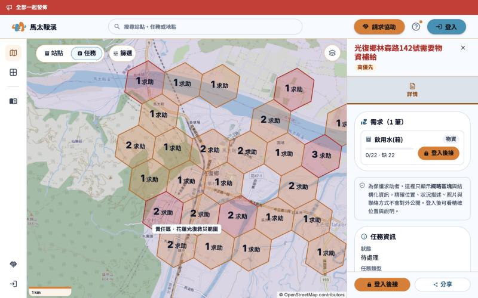
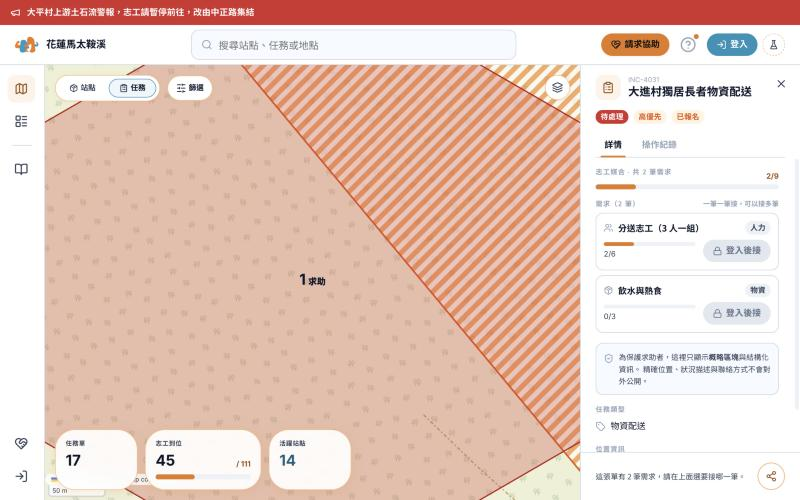

# 前台任務單詳情：原型 vs staging 差異（給前端）

2026-11-01 更新 · 範圍：前台地圖／列表點開任務單後的詳情面板
原型：`js/site/site-detail.jsx` 的 `TicketDetail`（含 `NeedRow`）
前端：`Frontend/libs/modules/src/ticket/task-match/task-match-ticket-detail.tsx`、`task-match-ticket-details-panel.tsx`、`ticket/needs/*`

## 比對基準

- 程式差異：**`GuangFuHero/optimized-version` 的 `main`（`df57493`，10/31 08:34 PT）原始碼**。
- 視覺差異：10/31 實際打開 `staging.wan-guard.com`（訪客、桌機 1280×800）與原型（本機，訪客、同一視窗大小）各拍一張、量了計算後樣式。**登入後的畫面沒拍**（不能代為登入），所以建立者的 ⋯ 選單、再加需求、資料檢核提醒等只比了原始碼。
- 只比任務單詳情，不含站點詳情、格子（CellDetail）、承接對話框。
- 前端程式註解很多地方寫「as the prototype has it」，骨架本來就是照原型做的。下面只列**有出入的**。

## 原型的詳情頁資料在哪裡

路徑從 repo 的 `Design/前台/` 起算（光復超人 `sucrelindesign` 分支）。看畫面：開 `前台地圖 Site Map.html` 或 `前台列表 Site List.html`，點任一張任務單。

| 要找什麼 | 檔案 | 位置 |
|---|---|---|
| 詳情面板本體 | `js/site/site-detail.jsx` | `TicketDetail`（任務單）；`NeedRow`／`NeedList`（每筆需求與承接鈕） |
| 示範任務單資料 | `js/site/site-data.js` | `ticketMeta`（狀態、優先級、聯絡人、地址、樓層、照片）；`tk-5001` 起是同一棟多樓層的示範單 |
| 訪客遮罩規則 | `js/site/site-data.js` 檔頭 | 未登入時不給地址、聯絡人、照片、說明，只給概略格子 |
| 承接、取消承接、建立者刪單 | `js/shared/wg-bridge.js` | 前後台共用，承接紀錄以「任務單＋需求」為單位 |
| 承接確認框、疑似重複的標記與提示 | `js/site/site-actions.jsx` | `compareForDup`、`SiteDupBadge`、`SiteDupNotice` |
| 照片縮圖 | `js/shared/wg-photos.jsx` | `TKPhotoThumb`、`tkPhotoList` |
| 同一棟的「看各樓層」「上一張／下一張」 | `js/site/site-building.jsx` | 原型用地址字串比對；正式版是 `buildingMapUuid` |
| 刪除後的分享連結怎麼接上 | `js/site/site-map.jsx`、`site-list.jsx` | 搜 `removedId`、`siteTicketExists` |

任務單已刪除的畫面，前端已在 PR #192、#193 處理（見 B5），不需要另外照設計稿做。

## 視覺差異（訪客、桌機 1280×800；詳情面板寬度兩邊都是 352px）

截圖放在 repo 的 `Design/前台/docs/前台任務單詳情差異/`（`sucrelindesign` 分支）：

**staging**（物資單「光復鄉林森路142號需要物資補給」）— `Design/前台/docs/前台任務單詳情差異/staging-詳情-訪客.jpg`

**原型**（物資單「大進村獨居長者物資配送」）— `Design/前台/docs/前台任務單詳情差異/原型-詳情-訪客.jpg`

兩邊不是同一張單，只比版型。數值是瀏覽器量到的計算後樣式。

| # | 項目 | staging | 原型 |
|---|---|---|---|
| V1 | **標題顏色與大小** | **紅色 `#BA1A1A`**，20px／600 | 深灰藍 `#0F172A`，18px／700 |
| V2 | 標題下的標籤 | 只有「高優先」一顆（14px，底 `#FFF3E0`、字 `#A33900`）。狀態寫在下面「任務資訊」 | 三顆：待處理（紅底白字）、高優先、已報名（12px） |
| V3 | 分頁列 | 整條灰藍底 `#DBE3EC`，「詳情」前面有圖示，選中字色 `#954900`，14px／600，字距 0.6px，下方底線 | 純文字分頁「詳情｜操作紀錄」，沒有灰底 |
| V4 | **區塊容器** | 每個區塊（需求、任務資訊）是**白底卡片**：1px 邊框、padding 16，標題 17px／800，標題前有圖示 | 沒有卡片，區塊靠間距分開；區塊小標是 11px／700 灰色（`#94A3B8`） |
| V5 | **卡片圓角** | **36px**（程式寫 `borderRadius: 3`，被主題當成 12px 的 3 倍） | 12px |
| V6 | 資料列文字 | 標籤 14px／700 `#64748B`；值 16px | 標籤 11px／700 `#94A3B8`；值 14px |
| V7 | 需求列 | 需求名 16px／700，右上種類標籤，下方進度條與數字 | 需求名 14px／700，種類標籤在右，進度條較細 |
| V8 | 訪客的承接鈕 | **橘色實心**「登入後接」，仍可點（導去登入） | **灰色停用**「登入後接」 |
| V9 | 頁尾 | 一整列：橘色「登入後接」＋有字的「分享」外框鈕 | 多筆需求時是一行說明字＋只有圖示的圓形分享鈕 |
| V10 | 面板背景 | 面板底是淡灰藍，區塊卡片是白的 | 整個面板白底 |

**V5 要請前端確認**：卡片圓角 36px 看起來像 `borderRadius: 3` 被當成主題倍數，不確定是不是有意，原型的設計是 12px。

## 結論

骨架一致：需求清單放最前面 → 任務資訊（狀態、說明、類型、照片、聯絡人、位置）→ 頁尾承接＋分享。
差異集中在三塊：**staging 多了建立者的管理動作**、**原型多了三樣 staging 沒有的東西（操作紀錄、總進度、疑似重複）**、**任務單被刪除時的畫面**。

## A. staging 有、原型沒有

| # | 項目 | staging | 原型 |
|---|---|---|---|
| A1 | 資料檢核提醒 | 建立者本人看到最上方橘色提示：「協調人員正在確認你的求助單「標題」，有需要會跟你聯絡。」（`audit_issue`，不顯示原因） | 沒有 |
| A2 | 建立者的 ⋯ 選單 | 標題列右側「刪除整張單」（只有建立者） | 頁尾一顆垃圾桶「刪除媒合單」（`canDeleteMatchSheet`） |
| A3 | 建立者管理需求 | 每筆需求有操作選單（停止招募、刪除需求，各有確認框）；需求區下方有「再加一項需求」 | 沒有 |
| A4 | 責任區 | 位置資訊裡多一行負責單位文字（ADR-422），沒有責任區就不顯示 | 詳情沒有（只在地圖標籤點開才看得到）。**以 staging 為準，設計端會跟進，前端不用動** |
| A5 | 狀態列 | 「任務資訊」第一列「狀態」文字 | 標題下方彩色 Badge（未媒合／已報名／媒合完成） |
| A6 | 數量沒填 | 顯示「未填數量 · 已 N 人」，**不畫進度條** | 「（未填數量，先以 1 計）」並照 1 畫進度條 |
| A7 | 需求已滿足 | 按鈕文字「已滿足需求」（需求 `fulfilled` 或單已完成） | 只有「已滿」「已刪除」 |
| A8 | 自己是否已承接 | 取 API 的 `myAssignment` | 取 `claimedBy` 比對 viewerId |
| A9 | 隱私說明 | 概略區塊那段文字多了**照片**：「精確位置、狀況描述、照片與聯絡方式不會對外公開」 | 少了「照片」 |
| A10 | 載入與錯誤 | 重新讀取時先顯示快取；載入失敗有紅色 Alert；需求載入中顯示「載入需求中...」 | 沒有 |
| A11 | 分頁 | **只有「詳情」一個分頁**（刻意，見 P1） | 還有「操作紀錄」 |

## B. 原型有、staging 沒有

| # | 項目 | 原型 | staging | 備註 |
|---|---|---|---|---|
| B1 | **操作紀錄分頁** | 有，列出整張單的異動 | **刻意沒有**。歷史需要 `ticket.view_history`，前台不開，避免看到誰接了什麼（後端 ADR-286） | **原型該拿掉** |
| B2 | 志工媒合總進度 | 標題下一條「志工媒合 · 共 N 筆需求 3/5」＋進度條 | 沒有，只有每筆需求各自的進度 | **請補上**。不改後端：用每筆需求已有的「已承接數／需求量」加總即可 |
| B3 | 標題上方的任務編號 | 小字顯示 `propertyName`／id | 沒有 | 原型自己加的 |
| B4 | **疑似重複** | 標題旁「疑似重複」標記；詳情最上方列出哪些欄位重複、可點去看另一張（DUP-FE-201/202）；承接前並排確認 | **完全沒有** | 前端已規劃，等設計端提供資料後再確認；**這一版不用做** |
| B5 | **任務單已刪除的畫面** | 分享連結點開時在詳情面板內顯示（不跳頁）：已刪除→標題「這張任務單已刪除」；連結對不到單→標題「找不到這張任務單」。兩種都不顯示原內容（尤其聯絡方式），只留任務單編號和一顆「回到地圖／列表」，不放「重新建立」 | PR #192（後端 `ticketAvailability`）、#193（前台抽屜）已處理，**尚未合併**，所以 staging 還看不到 | **不用再做。** 合併後請對照左欄的兩個標題與「只留編號、不顯示原內容」這條規則核對一次 |
| B6 | 任務說明的資料來源 | `reviewNote`，沒有才用副標 | `description`，沒有才用副標 | 原型讀錯欄位，**以 staging 為準** |
| B7 | 沒地址時 | 「未填地址」，下方加「現場描述：…」 | 只有「未填地址」 | 小事，以 staging 為準即可 |

## C. 請前端處理與已決定的事

**請前端處理：**
1. **視覺差異（V1～V10）**：請以設計稿為準，優先處理標題顏色與大小、區塊卡片、圓角（V5：36px 看起來像 `borderRadius: 3` 被當成主題倍數，設計稿是 12px，請確認是不是有意）。
2. **B2 志工媒合總進度條**：請補上，位置與樣式看 `site-detail.jsx` 的 `TicketDetail`（標題下方「志工媒合 · 共 N 筆需求 3/5」加一條進度條）。
3. **B5 已刪除畫面**：#192、#193 合併後，請對照 B5 核對一次。

**已決定，前端不用處理：**
- B4 疑似重複：維持前端的規劃，等設計端提供資料。
- A4 責任區那一行：以 staging 為準。

**設計端（Sucre 側）會做：**
1. 拿掉「操作紀錄」分頁（B1），前台不開歷史。
2. 補上 A1、A3（建立者管理需求）、A6（未填數量不畫條）、A9 的文字。
3. 垃圾桶搬到標題列的 ⋯（A2），文案改成「刪除整張單」。
4. 詳情加上 A4 責任區那一行。

**還沒看畫面：** 登入後的詳情（建立者的 ⋯、再加需求、資料檢核提醒）、上一張／下一張與看各樓層、手機寬度排版。
