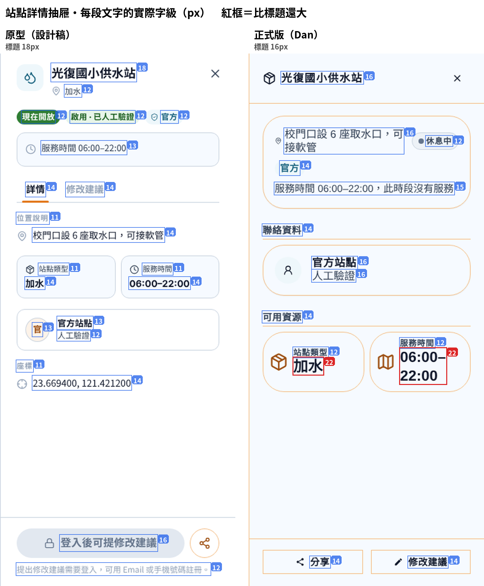

# 前台視覺對齊（給前端與 AI）

**比對基準：** 原型 `sucrelindesign`（`abb70758`，2026-10-24）vs 正式版 `main`（`0c752b61`，2026-10-24）
**比對方式：** 兩邊都在本機跑起來，餵同一批示範資料，以未登入的桌機（1440）與手機（390）逐頁比對，再對過程式碼。
**記號：** 🔒 已裁示，照做；⚠️ 要後端資料，沒有之前先不做

> 這份只列「正式版跟原型不一樣、而且要改」的地方，照優先順序排。
> 路徑都相對於 `Frontend/libs/modules/src/`，除非另外寫出。
> 一項做完就在標題後面加 ✅ 和 PR 編號，方便追。

---

## 一、優先處理

### 1. 🔒 詳情抽屜底部按鈕要有圓角（一定要改）

- **現況：** 按鈕是自己用 `ButtonBase` 刻的，寫死 `borderRadius: 0`，所以是直角。列表卡片上的「分享」是圓的，同一個「分享」一圓一方。
- **要改成：** 用設計系統的按鈕，膠囊形（`radius.full`），跟列表卡片上的「分享」一致。
- **檔案：**
  - `station/admin/station-detail/station-detail-footer-action.tsx`：`inlineActions` 與 `blockActions` 兩處（「分享」「修改建議」）
  - `ticket/needs/need-claim-button.tsx`：`footer` 那一組（「接這筆」）

### 2. 列表卡片右上角改顯示開放狀態

- **現況：** 右上角顯示站點類型（加水、避難…）。
- **要改成：** 顯示開放狀態（現在開放／休息中／暫停服務），跟詳情抽屜用同一套判斷。類型已經有左邊的圖示表示，不用再重複。
- **判斷邏輯：** `station/availability.ts` 已經寫好，直接用。
- **檔案：** `list/site-list-row.tsx`

### 3. 頂欄

- **現況：** 顯示平台名稱「島嶼守望」；登入只有圖示。
- **要改成：**
  - 顯示這次事件的名稱（例如「花蓮馬太鞍溪」）。
  - 登入改成有字的按鈕（圖示＋「登入」），不要只有圖示。
- ⚠️ 事件名稱要有後端欄位。沒有之前，先維持平台名稱，只改登入按鈕。
- **檔案：** `shell/site/top-navbar.tsx`、`shell/site/mobile-top-navbar.tsx`
- **原型出處：** `Design/前台/js/site/site-shell.jsx`

### 4. 登入頁

- **必填欄位加紅色星號：** 電子郵件（或手機號碼）、密碼。
- **「註冊帳號」改成橘框按鈕：** 現在是灰底。
- **不用改：** 左側主視覺維持現在的照片；Google／LINE 按鈕維持現在有品牌圖示的樣子。
- **檔案：** `auth/login/`
- **原型出處：** `Design/前台/js/site/site-auth.jsx`

---

## 二、一般

### 5. 🔒 地圖站點圖釘：藍底白圖示，每種類型各自的圖示

- **現況：**
  - 圖釘的圖示是深色。
  - 站點只有兩種手畫圖案：避難和臨時站點一種，其他（物資、醫療、加水、廁所…）全部共用一種，所以地圖上看不出是什麼站。
- **要改成：**
  - 藍底上的**圖示**用白色（`neutral.white`）。
  - 每種站點類型用自己的圖示，直接沿用 `station/type-options.ts` 裡已經定義好的類型圖示，不要再手畫 path。
  - 列表每一列左側的類型圓圈，照同一條規則改成白圖示。
  - 任務圖釘（橘底黑圖示）不用動。
- **規則（2026-10-25）：** 藍底（`brand.secondary`／`bg.secondary`）上，**文字維持黑色**（09-17 裁示，文字要 4.5:1）；**圖示用白色**。圖形只要求 3:1（WCAG 1.4.11），白色在 `#2592B9` 上是 3.56:1，合格。
- **檔案：** `map/components/map-marker/create-map-marker-icon.ts`（`getMarkerTone`、`buildMarkerGlyphSvg`）、`map/site/markers.ts`（`resolveStationVariant`）、`list/site-list-row.tsx`

### 6. 站點詳情抽屜版面

- **現況：** 標題下沒有任何標籤；內容分成「聯絡資料」「可用資源」兩區，但「聯絡資料」裡放的是驗證資訊，「可用資源」裡放的是類型和服務時間，標題跟內容對不上。
- **要改成（照原型）：**
  1. 標題下一列：狀態、驗證、官方標籤
  2. 服務時間
  3. 位置說明
  4. 類型／服務時間兩格
  5. 官方站點卡
  6. 座標
- 拿掉「聯絡資料」「可用資源」這兩個區塊標題。
- ⚠️ `station/admin/station-detail/station-detail-info-panel.tsx` 是跟後台共用的。改前台時不要影響到後台，建議前台另外接一個版面，或用參數切換。
- **原型出處：** `Design/前台/js/site/site-detail.jsx`

### 7. 🔒 區域顏色照類型固定（2026-10-23）

- 顏色**不存、不算、不給人選**，只看區域類型：
  - **危險區：** 橘白斜紋，加 `#E65100` 實線框
  - **責任區：** 靛色 `#4338CA`
  - **標示區：** 綠色 `#15803D`
- **現況：** 危險區（封閉區域）是米色填色加咖啡色虛線，在地圖上幾乎看不到。責任區、標示區前台還沒畫。
- **原型出處：** `Design/前台/js/shared/wg-hazard.js` 的 `polygonStyle`（斜紋）與 `wgZoneColor(kind)`（ZONE-COLOR-101／102）。背景見 `Design/後台/docs/互助地圖.md`。
- **檔案：** `map/components/rescue-map-canvas/index.tsx`（約 196–217 行）、`map/components/rescue-map-gis-overlay-layer/index.tsx`

### 8. 手機版「請求協助」

- **現況：** 右下角浮動膠囊。
- **要改成：** 底部滿版的橘色條，跟原型一樣。
- **檔案：** `ticket/help-request/mobile-request-help.tsx`
- **原型出處：** `Design/前台/js/site/site-shell.jsx` 的 `SiteMobileHelpFab`（名字叫 Fab，畫出來是滿版條）

---

## 三、可延後：圖示統一成 lucide

> 優先順序排在一、二之後。Dan 說過前台要換的東西太多，先不改；這裡記下來，有空再做。

- **現況：** 前台大部分用 MUI Rounded（47 個檔案、71 種圖示），地圖控制、圖層、位置相關的面板用 lucide（10 個檔案）。同一個畫面裡實心和線條混著用，例如地圖頁左上的站點／任務切換是實心，右上的圖層鈕是線條。另外還有 5 處 MUI Outlined、1 處 MUI 預設款。
- **目標：** 前台全部換成 lucide，用 `libs/ui` 的 `Icons`。這也是 `libs/ui/src/components/Icon/README.md` 寫的標準；後台已經是 lucide。
- **時程：** 標案結束前做得完就做。做不完可以等有空再改，但**標案結束前一定要先改 README**，把現況寫清楚，例如：

  > 前台目前用 MUI Rounded，後台用 lucide。前台之後會換成 lucide，新程式請直接用 `Icons`。

  不然 README 寫的跟程式不一樣，下一個人或 AI 會照 README 寫，又多一套混用。

---

## 四、最低：字級

> 優先順序最低，前三區做完、有空再看。
> **原型這邊也還沒跟上：** 10-14 決定桌機字級全部加 2px，正式版的 `displayTextSize` 已經加了，原型的 `site.css` 還沒改。兩邊目前不一致，所以這一區先不要大改，只處理明顯顛倒的地方。

**唯一要先處理的：站點詳情抽屜大小顛倒。**
站點詳情抽屜沿用了後台元件，字級是後台寫死的，沒有用前台的 `displayTextSize`。結果是值比標題還大：

| 文字 | 原型用的 | 正式版要用 | Dan 現在（桌機） |
|---|---|---|---|
| 抽屜標題「光復國小供水站」 | `--fs-18` 粗體 | `displayTextSize[18]` | 16 |
| 標題下的類型「加水」 | `--fs-12` | `[12]` | 沒有 |
| 狀態、驗證、官方標籤 | `--fs-12` 粗體 | `[12]` | 12–14 |
| 服務時間那一列 | `--fs-13` | `[13]` | 15 |
| 小標（位置說明、站點類型、服務時間、座標） | `--fs-11` | `[11]` | 12–14 |
| 內文（位置說明內容、座標值） | `--fs-14` | `[14]` | 16 |
| **值（「加水」「06:00–22:00」）** | `--fs-14` 粗體 | `[14]` | **22** |
| 官方站點卡：「官方站點」／「人工驗證」 | `--fs-13`／`--fs-12` | `[13]`／`[12]` | 16／16 |

**規則（之後的新程式照這條）：** 前台文字一律用 `displayTextSize[原型的 --fs 編號]`，不寫死 px。沿用後台元件時，要換成前台字級。

---

## 已經一致，不用動

外框（頂欄＋左側欄）、站點／任務切換、篩選選單、請求協助抽屜、公告橫幅、訪客格子樣式、行前資訊內文版面。

## 不在這份裡

- **行前資訊：** Ethan 的後台編輯器在 `feat/briefings` 等分支上，等 review。內容格式是 Markdown，跟前台一致。

## 決定紀錄

| 日期 | 決定 |
|---|---|
| 2026-10-23 | 區域顏色照類型固定，不存、不算（見第 7 項） |
| 2026-10-25 | 藍底上的圖示用白色、文字維持黑色（見第 5 項） |
| 2026-10-25 | 介面色維持 `#E3791E`（橘）／`#2592B9`（藍），**不改成** logo 色 `#EF7C14`／`#1A9BC7`：logo 色太亮，大面積用在介面上不舒服 |
| 2026-10-25 | 圖示統一成 lucide，可延後；來不及就先改 README（見第三區） |
