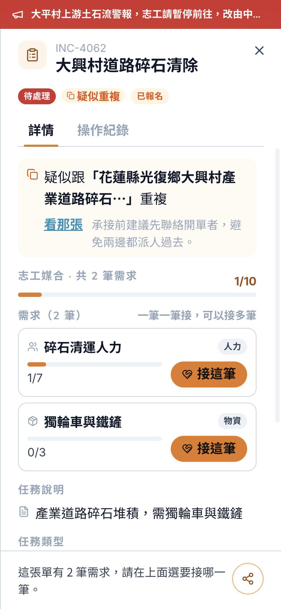
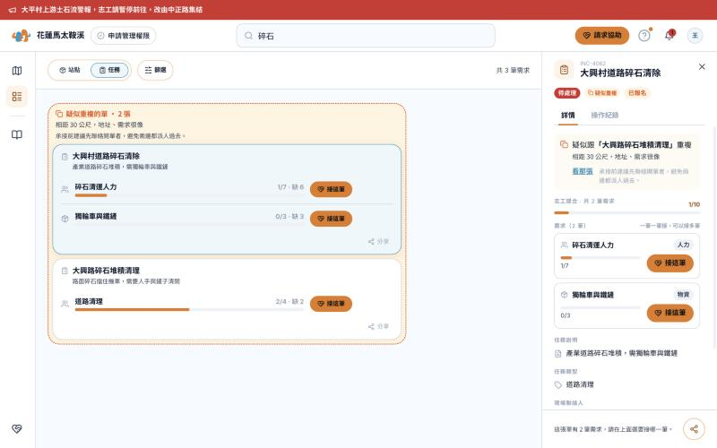

# 疑似重複：「看那張」放在句子下面（2026-11-01，回 #221）

> 給前端。回 #221「For the designer」兩題。🔒 已裁示。

## 1. 手機上句子斷行 → 「看那張」移到句子下面

- 🔒 **DUP-FE-207**：詳情最上面的提醒，「看那張」放在「疑似跟『XXX』重複」**下面**，跟「承接前建議先聯絡開單者，避免兩邊都派人過去。」**同一排**（按鈕在左、提醒在右，提醒太長自己換行）。
- 🔒 標題**維持最多 16 字**（DUP-FE-206：超過就留 15 字＋「…」）。❌ 不要用截更短來解——標題是讓人認出「是哪一張」的，砍短就認不出來。
- 理由：放在句子右邊時，390px 手機上 16 字的標題會把整句折成三行、「重」「複」被拆到兩行；移到下面後，最長的標題兩行就收完，「重複」不會被拆開。
- 一張單有好幾張疑似重複時：每張的句子下面各一顆「看那張」，承接提醒只在最後一張那排出現一次。

（桌機那張是原型，有「相距 30 公尺，地址、需求很像」那一行，見第 2 點。）

## 2. 沒有「為什麼像」 → 這一版只寫是哪一張就夠

- 🔒 #216 目前只回是哪幾張、沒回原因，**這一版不寫原因**。志工真正要做的是「看那張」和「先聯絡開單者」，這兩個都有了。
- 等後端有原因的欄位，再在句子下面補一行「相距 N 公尺，地址、需求很像」（原型 `js/site/site-actions.jsx` 的 `DupChips` 是之後的樣子）。

## 原型

Netlify 原型 `js/site/site-actions.jsx` 的 `SiteDupNotice`（規則寫在程式碼註解 DUP-FE-207）。
