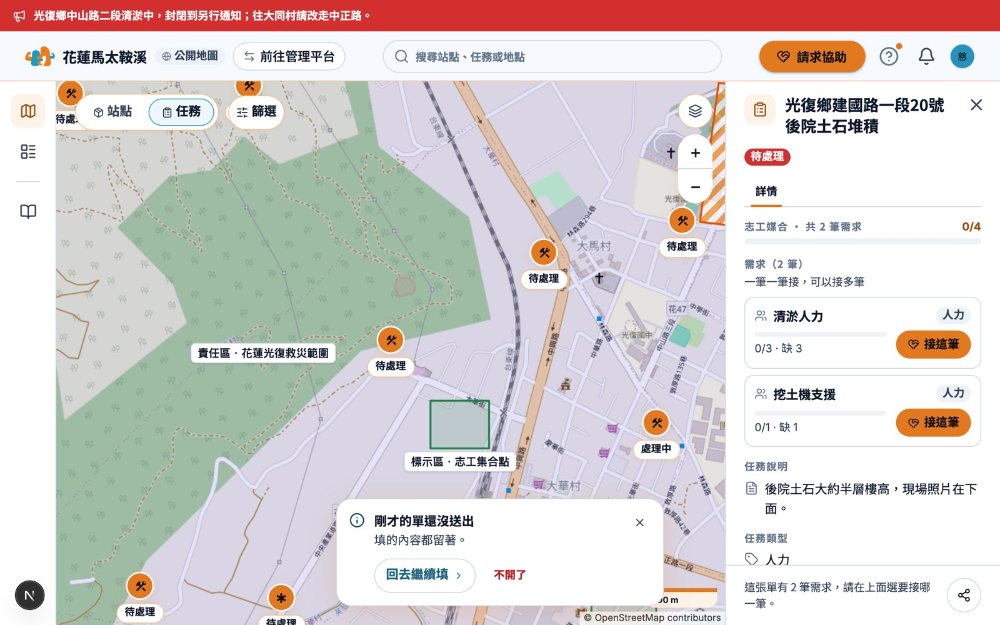
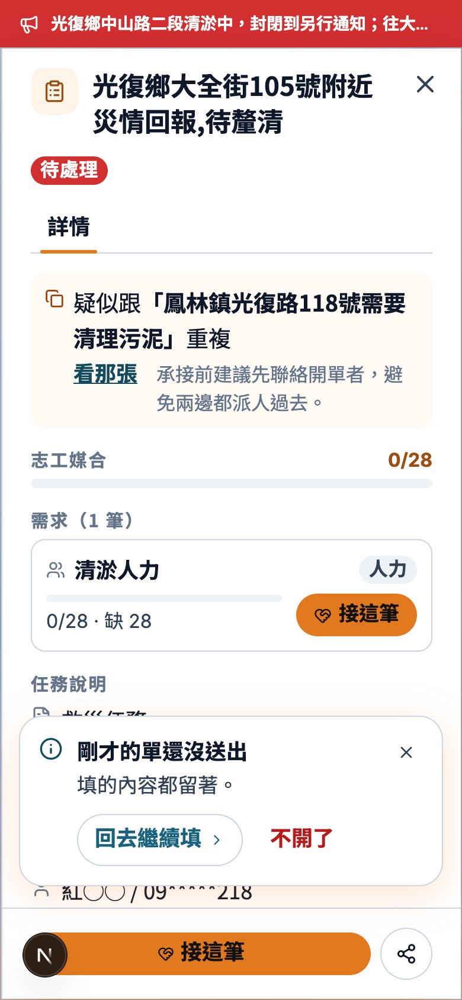
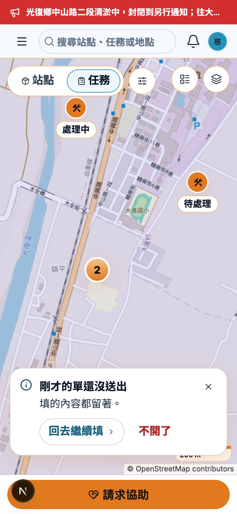

# 開單還沒送出（2026-11-04）

> 給前端。送出時跳「疑似重複的單」，使用者按「看這張」之後的卡片。🔒 已裁示。

## 卡片

- 🔒 **DUP-FE-115**：「剛才的單還沒送出」**不會自己消失**。他正在讀另一張單，6 秒不夠，卡片一消失就沒有人告訴他表單還留著。
- 卡片留到下面三個動作之一：

| 動作 | 卡片 | 草稿 |
|---|---|---|
| 回去繼續填 | 關掉 | 帶回表單 |
| 不開了 | 關掉 | 清掉 |
| ✕ | 關掉 | 留著，之後按「請求協助」帶回 |

- 按別的地方、按 Esc 都不會關掉卡片。
- 「不開了」用紅字 ghost（BTN-103）。
- 圖示用資訊，不用綠色打勾：這時候什麼都還沒送出。

## 手機

- 🔒 卡片放在底部，**讓出「接這筆」那一列**，離畫面底部 96px（再加 iPhone home indicator）。卡片不會自己消失，蓋在主要按鈕上就按不到。
- 不放畫面上方：卡片會一直蓋住地圖控制列或單名。
- 320px 寬時「不開了」換到下一行。

## 第二版

- 從地圖開單時，問要帶回還是清除上次的草稿，一次只記一筆。草稿存在瀏覽器分頁裡，不用後端。
