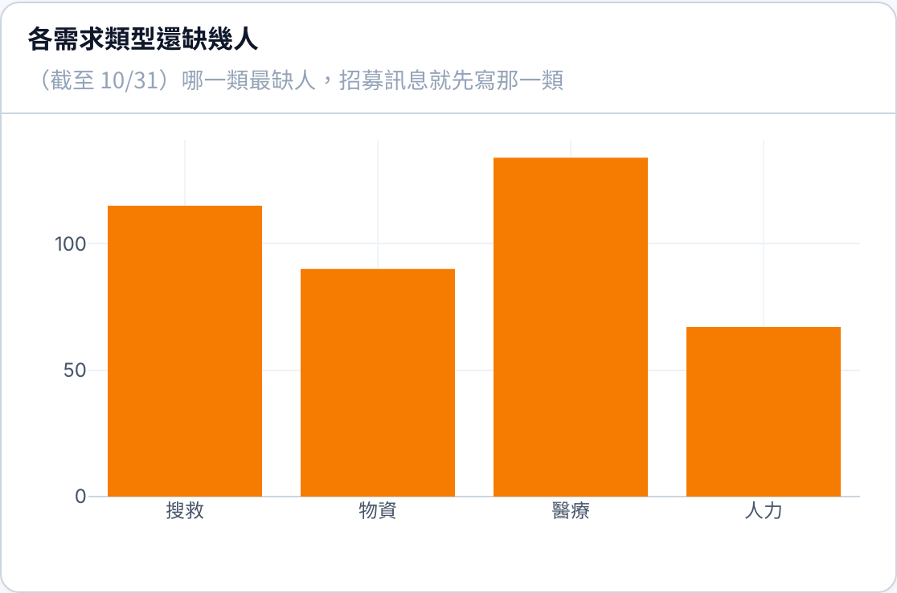

# 儀表板：志工三個數字、缺口趨勢、地區與區塊篩選

2026-11-01 · 回前端提問（09-27 設計稿沒畫到的部分）
2026-11-02 更新 · 三個數字的定義照後端、缺口不是相減、圖只畫缺口、地區做到村里
原型：Netlify `總覽儀表板 Dashboard.html`（假資料）。交付分支沒有儀表板頁，這份是唯一的設計說明。

標 🔒 的照這樣做；標 🚨 的是設計端先定、未經團隊裁示；標 ⏳ 的要後端回答。

---

## 一、志工三個數字

- 🔒 放在任務單區 6 張 KPI 卡的下面，一排三張：**志工需求人數**（人）／**已媒合**（人次）／**志工缺口**（人）
- 🔒 志工缺口 > 0：整張卡用警示色（`bg.warning.subtle` 底、`bg.warning.hover` 框、`fg.warning` 數字＋三角警示圖示），下面寫「N 項需求還缺人」；= 0 寫「目前沒有缺人的需求」
- 🔒 **志工缺口要跟任務管理列表上方的「志工缺口」同一個數字**（後端 `ticketStats` 的 `gapPeople`／`gapNeeds`）。同一個名字兩頁數字不同，指揮官不知道該信哪個
- 🔒 **2026-11-02 三個數字算的範圍不一樣**（照後端 `ticket_analytics.get_volunteer_metric`）：
  | 卡片 | 算哪些需求 | 卡片上的說明（滑過也是這句） |
  |---|---|---|
  | 志工需求人數 | 沒取消的需求（**含已額滿、已結束**） | 沒取消的需求總共要幾個人（含已額滿、已結束；只算有寫人數的） |
  | 已媒合 | 同上 | 這些需求上已經被承接的名額。同一人接兩筆算 2 |
  | 志工缺口 | **只算還在招募的**（沒額滿、沒停止招募） | 還在招募的需求還差幾人（不是需求人數減已媒合）。跟任務管理列表上方的「志工缺口」是同一個數字 |
- 🔴 **所以志工缺口 ≠ 需求人數 − 已媒合**（已結束沒招滿的、超過人數的都會讓相減對不上）。畫面上**不要寫成相減**、也**不要把三個並排成可以相減的樣子**；請直接用後端 catalog 給的說明
- 🚨 已媒合算**名額**（承接筆數，同一人接兩筆算 2），單位寫「人次」（後端目前寫「人」，之後再統一）
- 🚨 只算有寫人數的需求（沒寫數量的需求算不出缺幾人）

## 二、「截至某天」跟「這段期間建立」分開

- 🔒 志工三張卡第二行寫 **截至今日**（粗體）；結束日不是今天時寫 **截至 10/31**。「截至」＝篩選的結束日
- 🔒 原本 6 張卡第二行寫 **近 30 天建立**／**近 7 天建立**；自訂日期時寫 **10/02–10/31 建立**。不寫死「近 30 天」
- 🔒 三張卡下面一行說明（11-02 改）：「這三個是『截至今日』的總數，不是這段期間建立的。需求人數、已媒合算沒取消的需求（含已額滿、已結束）；志工缺口只算還在招募的，所以不是前兩個相減。跟著地區、需求類型篩選；不受狀態篩選影響。」
- 🚨 範圍那句放在卡片名稱**下面一行**，不放在標題括號裡：6 張卡很窄，放括號會把「任務單總量（近 30 天建立）」折成兩半
- 任務單總量的說明改成「這段期間總共建立了幾張任務單」（原本寫「事件開始到現在」，跟「近 30 天建立」矛盾）
- ✅ **過去某天算得出來**（11-02 後端確認：用異動紀錄還原那天的需求與承接）→ 選 10/31 就是那天結束時的數字，**不用做「只能看今天」**；缺口趨勢線也一樣

## 三、兩張圖

- 🔒 **志工缺口每天的變化**（折線，橘色）放首屏，緊接在三張卡下面、整列寬。說明：「每一天結束時還缺幾個人。線往下＝補人的速度追上需求，往上＝該再招募」
- 🔄 **各需求類型還缺幾人**（11-02 改：**只畫缺口**，橘色長條）放進「展開細部分析」，不放首屏。原本「需求／已媒合／缺口」三根並排，看的人會拿前兩根相減，但缺口不是相減出來的

## 四、篩選

- 🔒 篩選列加第二排 **地區 · 整頁都套**：**縣市 → 鄉鎮市區 → 村里**（11-02 後端確認村里有欄位，從地址拆出來），可以停在任一層；上一層沒選時下一層停用（寫「先選縣市」「先選鄉鎮市區」）；選了任一個出現「清除地區」
- 🚨 選了村里時，篩選列下面多一行小字：「只算地址有寫到村里的單；地址沒寫村里的不會算進『大進村』。」（地址沒寫村里的單拆不出村里）
- 🔒 「類型」「狀態」放在**各區塊標題右邊、只套那一區**（任務單與站點的選項不同）。第二排右邊寫明「類型、狀態在各區塊標題右邊，只套那一區」
  - 任務單區：**需求類型**（人力／物資／搜救…，是 `ticket_tasks.task_type`，不是任務單類型）＋**狀態**（未指派／進行中／已完成／已取消）
  - 資源站點區：**類型**＋**營運狀態**
- 🔒 志工三張卡與兩張圖跟著**地區**、**需求類型**篩選，**不跟狀態**（缺口本來就只算還沒結束的需求）

## 原型程式對照（在 Netlify 原型的 repo，不在這個分支）

- 版面：`js/admin/dashboard/db-app.jsx` 的 `VolunteerRow`、`VolunteerChart`、`MiniSelect`、`createdLabel`／`asOfLabel`
- 假資料與規則註解：`js/admin/dashboard/db-data.js` 的 `DB_volunteer`、`DB_REGIONS`、`DB_TERM.volunteer_*`
- 原型裡篩了之後數字依固定比例縮小，只為了看得出「有在篩」，不是算法
