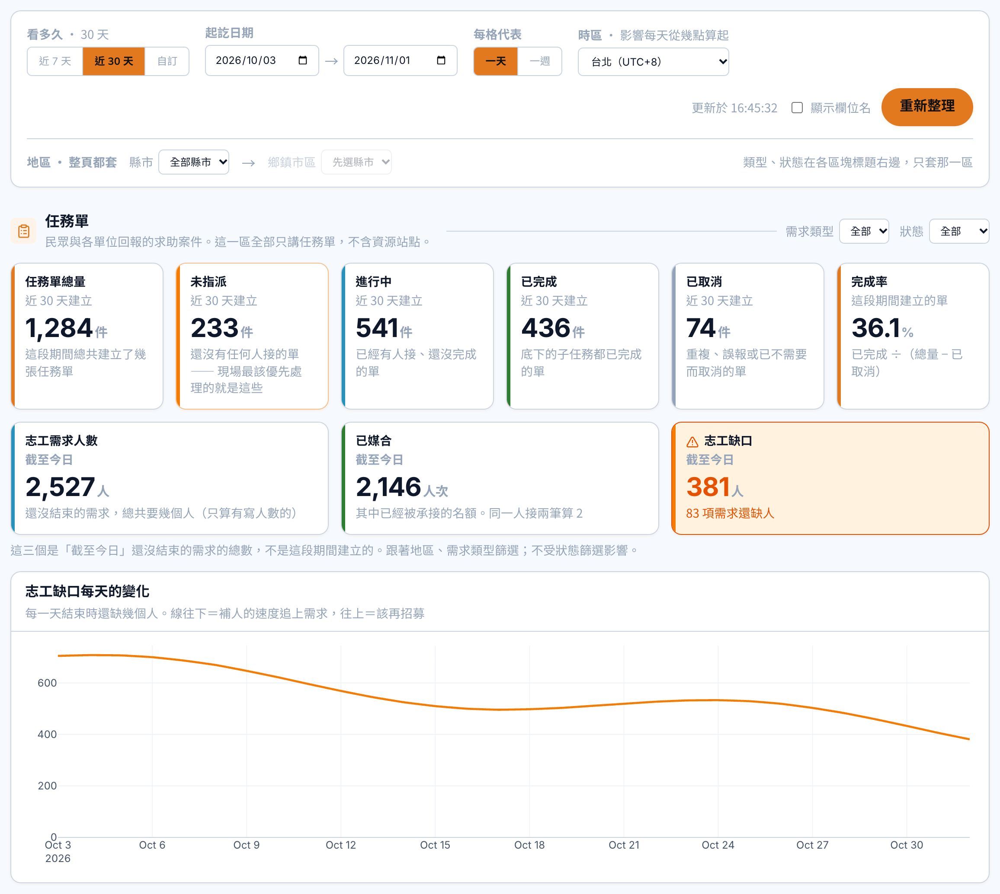
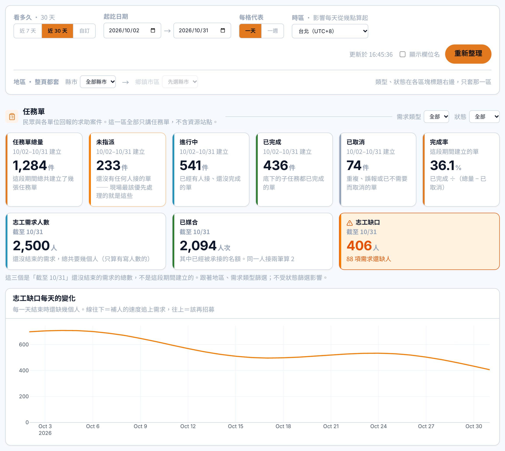
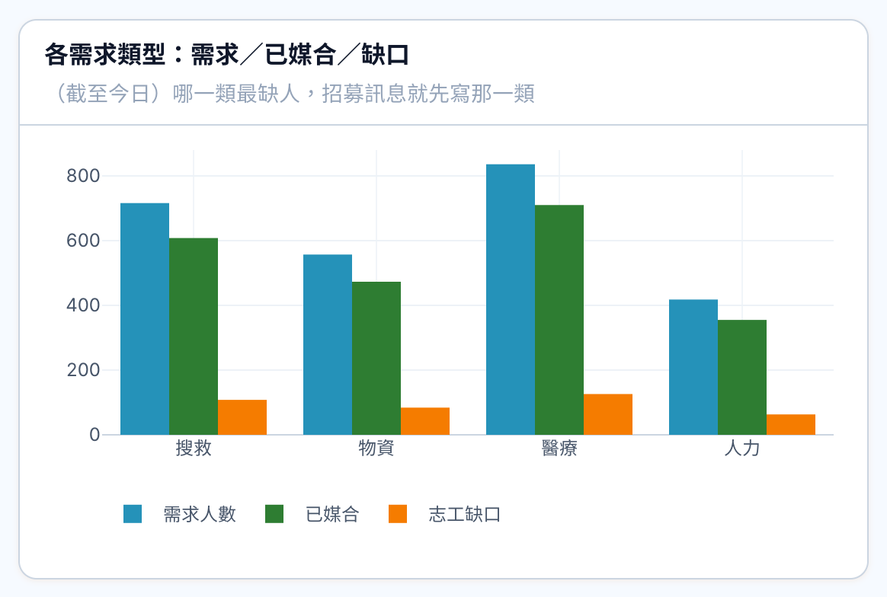
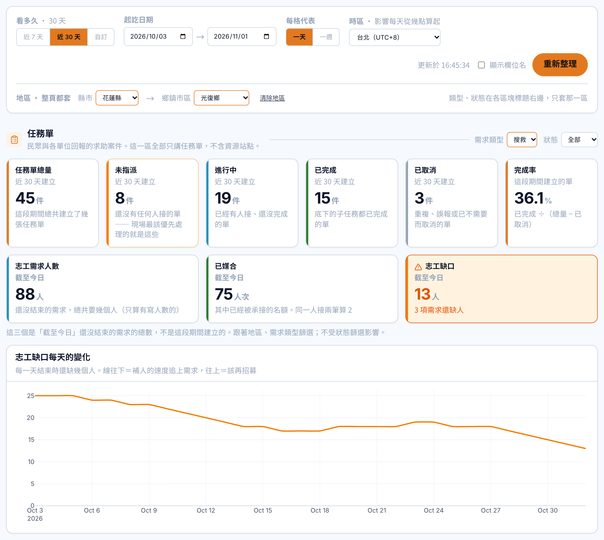
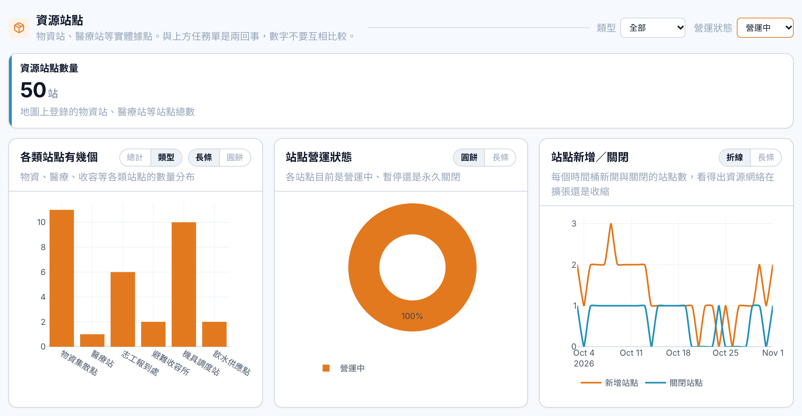

# 儀表板：志工三個數字、缺口趨勢、地區與區塊篩選

2026-11-01 · 回前端提問（09-27 設計稿沒畫到的部分）
原型：Netlify `總覽儀表板 Dashboard.html`（假資料）。交付分支沒有儀表板頁，這份是唯一的設計說明。

標 🔒 的照這樣做；標 🚨 的是設計端先定、未經團隊裁示；標 ⏳ 的要後端回答。

---

## 一、志工三個數字

- 🔒 放在任務單區 6 張 KPI 卡的下面，一排三張：**志工需求人數**（人）／**已媒合**（人次）／**志工缺口**（人）
- 🔒 志工缺口 > 0：整張卡用警示色（`bg.warning.subtle` 底、`bg.warning.hover` 框、`fg.warning` 數字＋三角警示圖示），下面寫「N 項需求還缺人」；= 0 寫「目前沒有缺人的需求」
- 🔒 **志工缺口要跟任務管理列表上方的「志工缺口」同一個數字**（後端 `ticketStats` 的 `gapPeople`／`gapNeeds`）。同一個名字兩頁數字不同，指揮官不知道該信哪個
- 🚨 已媒合算**名額**（承接筆數，同一人接兩筆算 2），所以單位寫「人次」，才能跟需求人數相減得出缺口
- 🚨 只算有寫人數的需求（沒寫數量的需求算不出缺幾人）

## 二、「截至某天」跟「這段期間建立」分開

- 🔒 志工三張卡第二行寫 **截至今日**（粗體）；結束日不是今天時寫 **截至 10/31**。「截至」＝篩選的結束日
- 🔒 原本 6 張卡第二行寫 **近 30 天建立**／**近 7 天建立**；自訂日期時寫 **10/02–10/31 建立**。不寫死「近 30 天」
- 🔒 三張卡下面一行說明：「這三個是『截至今日』還沒結束的需求的總數，不是這段期間建立的。跟著地區、需求類型篩選；不受狀態篩選影響。」
- 🚨 範圍那句放在卡片名稱**下面一行**，不放在標題括號裡：6 張卡很窄，放括號會把「任務單總量（近 30 天建立）」折成兩半
- 任務單總量的說明改成「這段期間總共建立了幾張任務單」（原本寫「事件開始到現在」，跟「近 30 天建立」矛盾）
- ⏳ **後端算得出過去某天的需求／媒合嗎？**（那天誰已承接、誰後來放掉）算不出來的話：結束日不是今天時，這三張卡寫「只能看今天」並停用；缺口趨勢線同理

## 三、兩張圖

- 🔒 **志工缺口每天的變化**（折線，橘色）放首屏，緊接在三張卡下面、整列寬。說明：「每一天結束時還缺幾個人。線往下＝補人的速度追上需求，往上＝該再招募」
- 🚨 **各需求類型：需求／已媒合／缺口**（分組長條：藍／綠／橘）放進「展開細部分析」，不放首屏

## 四、篩選

- 🔒 篩選列加第二排 **地區 · 整頁都套**：縣市 → 鄉鎮市區，可以只選縣市；沒選縣市時鄉鎮市區停用（寫「先選縣市」）；選了任一個出現「清除地區」
- ⏳ **村里**：後端地址（`secondary_locations`）沒有村里欄位，等後端確認前先做到鄉鎮市區
- 🔒 「類型」「狀態」放在**各區塊標題右邊、只套那一區**（任務單與站點的選項不同）。第二排右邊寫明「類型、狀態在各區塊標題右邊，只套那一區」
  - 任務單區：**需求類型**（人力／物資／搜救…，是 `ticket_tasks.task_type`，不是任務單類型）＋**狀態**（未指派／進行中／已完成／已取消）
  - 資源站點區：**類型**＋**營運狀態**
- 🔒 志工三張卡與兩張圖跟著**地區**、**需求類型**篩選，**不跟狀態**（缺口本來就只算還沒結束的需求）

## 原型程式對照（在 Netlify 原型的 repo，不在這個分支）

- 版面：`js/admin/dashboard/db-app.jsx` 的 `VolunteerRow`、`VolunteerChart`、`MiniSelect`、`createdLabel`／`asOfLabel`
- 假資料與規則註解：`js/admin/dashboard/db-data.js` 的 `DB_volunteer`、`DB_REGIONS`、`DB_TERM.volunteer_*`
- 原型裡篩了之後數字依固定比例縮小，只為了看得出「有在篩」，不是算法
