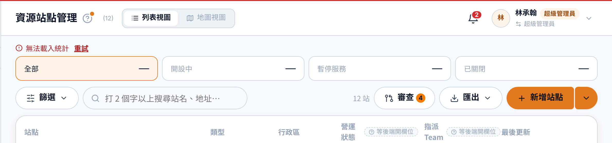
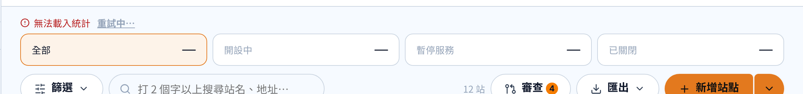
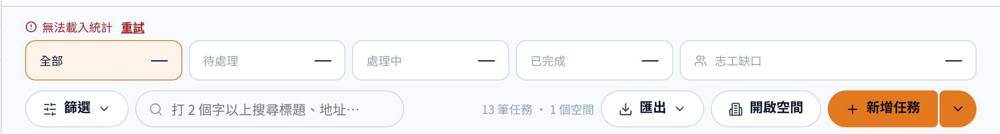
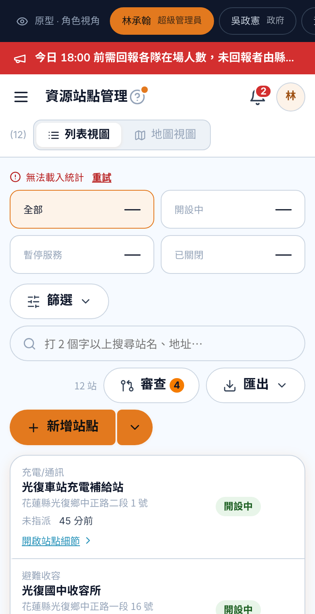

# 列表上方統計：數字讀不到時（STAT-109）

2026-11-02 · 任務管理、資源站點同一個做法 · 原型程式 `js/shared/wg-stat-tiles.jsx`（`StatTilesRetry`、`useWGStatLoad`）
看原型：網址加 `?stats=fail`（第一次按「重試」會成功）

標 🔒 的照這樣做；標 🚨 的是設計端先定、未經團隊裁示。

- 🔒 **統計只是列表的附屬，提示不佔篇幅**（Sucre）：不用 Callout 色塊，改成格子上方**一行紅色小字**：⚠ 無法載入統計　**重試**（字 13px、高約 24px、跟格子間距 4px）
- 🔒 下面那排格子**照樣出現**，數字全部寫「—」（STAT-108），還是可以點來篩選；警示格（志工缺口）數字不知道時**不上警示色**
- 🔒 只擋這一排，不擋整頁：統計跟列表是兩支 API，統計壞掉不代表列表壞掉
- 🔒 按「重試」：字變「重試中…」並停用；成功後那行字消失，失敗就留著

- 🚨 「重試」可點範圍高 24px，比按鈕守則 sm 的 44px 小 —— 為了不佔篇幅；要補可以只把可點範圍往外加大、看起來不變

## 跟 staging（PR #232）的差別

staging 的 `StatTilesRetry`（`Frontend/libs/modules/src/admin/shared/stat-tiles.tsx`）用 `Callout tone="danger"`＋「無法載入統計，請稍後再試」＋ ghost 按鈕「重試」。
已在 PR #232 留 suggestion（取代第 253–260 行），另外要一起改：
1. import 加 `CircleAlert`（lucide-react），拿掉沒再用到的 `Callout`、`Button`
2. `station-stats-strip.tsx`、`ticket-stats-strip.tsx` 外層 `gap: '12px'` → `'4px'`
