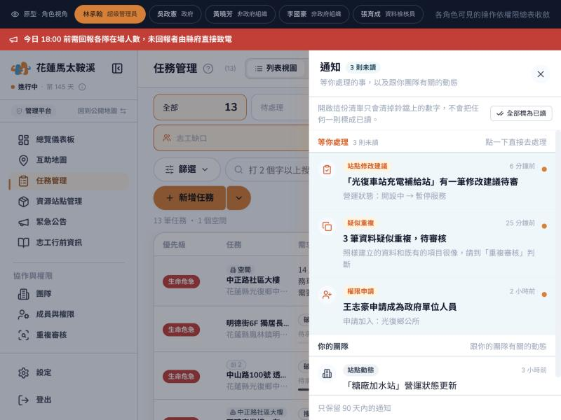
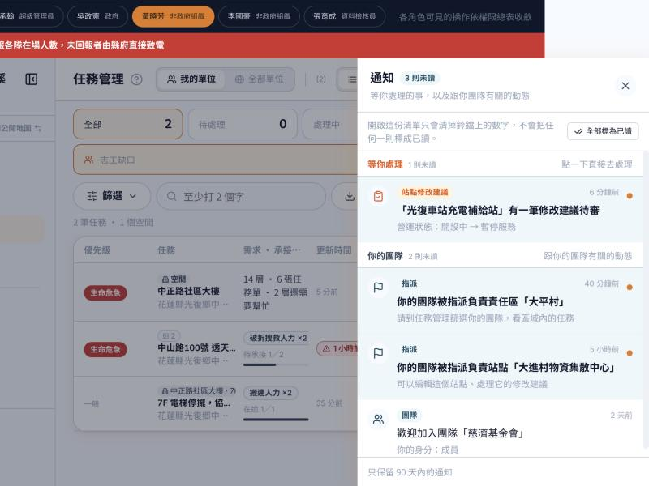

# 通知鈴鐺（管理平台）

2026-11-03 · 後台頂欄右上角的鈴鐺 · 原型程式 `js/admin/shell/wg-notify.jsx`
看原型：任務管理網址加 `?demo=1`，點右上角鈴鐺；用最上方角色列切換身份（林承翰＝超管、吳政憲＝政府、黃曉芳＝非政府組織管理員、張育成＝資料檢核員）
線上原型：https://wan-guard-prototype.sucrelin-design.workers.dev/%E4%BB%BB%E5%8B%99%E7%AE%A1%E7%90%86%20Ticket%20Management

標 🔒 的照這樣做；標 🚨 的是設計端先定、未經團隊裁示。

🔒 **這個功能叫「通知鈴鐺」，不叫「抽屜」**（Sucre）。畫面上點開鈴鐺出現的是「通知清單」。

## 分兩組

🔒 照「要不要我去做事」分兩組，**等你處理**在上、**你的團隊**在下（Sucre）。分組只看通知的種類（`type`），不看已讀。

| 組 | 通知 | 後端 `type` | 點了去哪裡 |
|---|---|---|---|
| 等你處理 | 站點有修改建議待審 | `station_suggestion_created` | 資源站點管理，打開那個站點（審查） |
| 等你處理 | 疑似重複待審核 | `dedup_review_pending` | 重複審核 |
| 等你處理 | 有人申請管理權限 | `role_request_submitted` | 成員與權限的審核佇列 |
| 你的團隊 | 站點指派給你的團隊／解除 | `station_assigned`、`station_unassigned` | 資源站點管理，打開那個站點 |
| 你的團隊 | 責任區指派給你的團隊／解除 | `zone_assigned`、`zone_unassigned` | 互助地圖，選到那個責任區 |
| 你的團隊 | 加入團隊、團隊暫停 | `team_member_added`、`team_suspended` | 團隊 |
| 你的團隊 | 站點營運狀態更新、新建站點 | `resource_station_updated` | 資源站點管理，打開那個站點 |

- 組的標題：「等你處理」橘色、右邊寫「點一下直接去處理」；「你的團隊」灰色、右邊寫「跟你的團隊有關的動態」。往下捲時組的標題停在上方
- 每則：圖示＋種類標籤＋時間；一行摘要（未讀粗體、淡藍底、右邊橘點）；一行細節
- 🚨 互助地圖（#175）、重複審核（#205）、成員與權限（#146）還沒合的話，點了先開該頁就好

## 鈴鐺上的數字

- 🔒 **站點營運狀態更新、新建站點不算進鈴鐺數字**，通知清單裡照樣列出（Sucre）。理由：政府隊每個站點一改就收到一則，災害期間一天幾十則，會把「等你處理」淹沒。鈴鐺數字應該等於「有幾件事要你處理」
- 開清單只清掉鈴鐺數字，不把任何一則標成已讀；點一則或按「全部標為已讀」才算已讀（同前台）

## 句子由前端寫

- 🔒 中文句子由前端依 `type` 組（Sucre 選）。已請後端在通知多給一個欄位（例如 `params`：站名、欄位代號），⏸ 等後端回時間
- 欄位還沒好之前：先照後端的 `title`、`body` 顯示
- 原因：後端原文有 emoji（🏢、⚠️、📝）、站點一律寫「物資站」、責任區寫「工作分區」，站點建議待審的內文是英文欄位代號（`operational_status`）而且沒寫是哪個站
- 🚨 原型裡的句子是設計端擬的，例：「你的團隊被指派負責責任區「大平村」」「「糖廠加水站」營運狀態更新」

## 空白畫面

列出會出現的五種：站點有修改建議待你審核、有資料疑似重複待審核、有人申請管理權限、站點與責任區指派給你的團隊、加入團隊與團隊暫停。不放按鈕（通知是別人的動作產生的）。

## 拿掉的

- 每則右邊「關閉這個對象的通知」：後端沒有這個功能
- 頁尾「通知後端待建置」：後端已經有通知
